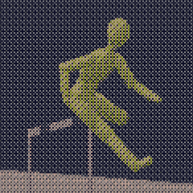
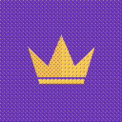

<table>
  <tr>
    <td align="center" width="33%" valign="top">
      
      <h3><a href="https://alicenoknow.pl">alicenoknow.pl</a></h3>
      my site: projects and how-it's-built write-ups of animations
    </td>
    <td align="center" width="33%" valign="top">
      
      <h3><a href="https://lekko.space">lekko.space</a></h3>
      Polish athletics results to explore in an interactive 3D stadium
        
      
    </td>
    <td align="center" width="33%" valign="top">
      
      <h3><a href="https://play.google.com/store/apps/details?id=com.alicenoknow.kingscup">King's Cup</a></h3>
      mobile party card game with 400+ monthly players
        
      
      
    </td>
  </tr>
</table>

### in the works

- 🐐 **Goatie**: mobile climbing platformer built on real Tatra elevation data
- 🌱 **Bamboost**: NFC plant care tracker that turns a scan of a plant into a 3D model
- ✅ **todoom**: todo app where finished tasks explode into letters

### say hi

stats refresh every Monday: downloads and rating from Google Play, visitors from Cloudflare
