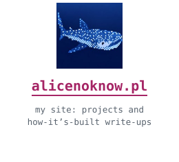
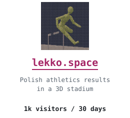
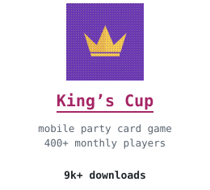

  <a href="https://alicenoknow.pl"><picture><source media="(prefers-color-scheme: dark)" srcset="cards/site-dark.svg"></picture></a>
  <a href="https://lekko.space"><picture><source media="(prefers-color-scheme: dark)" srcset="cards/lekko-dark.svg"></picture></a>
  <a href="https://play.google.com/store/apps/details?id=com.alicenoknow.kingscup"><picture><source media="(prefers-color-scheme: dark)" srcset="cards/kingscup-dark.svg"></picture></a>

 

  
  

