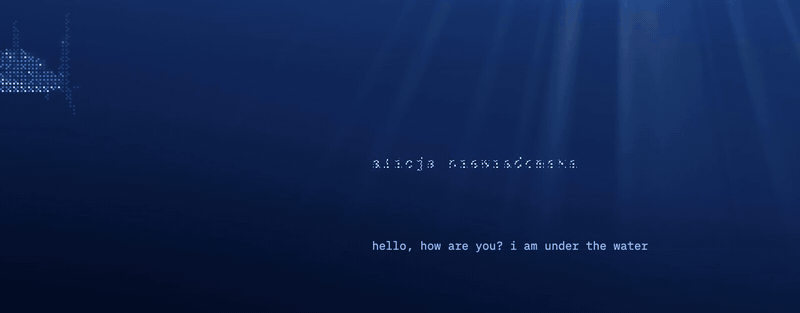
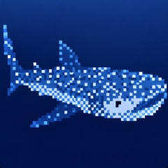

  
   
  <a href="https://alicenoknow.pl"><picture><source media="(prefers-color-scheme: dark)" srcset="assets/title-site-dark.svg"></picture></a>
   
  my site: projects and how-it's-built write-ups of animations

 

  
   
  <a href="https://lekko.space"><picture><source media="(prefers-color-scheme: dark)" srcset="assets/title-lekko-dark.svg"></picture></a>
   
  Polish athletics results to explore in an interactive 3D stadium
   
  

 

  
   
  <a href="https://play.google.com/store/apps/details?id=com.alicenoknow.kingscup"><picture><source media="(prefers-color-scheme: dark)" srcset="assets/title-kingscup-dark.svg"></picture></a>
   
  mobile party card game with 400+ monthly players
   
  

 

  
  

